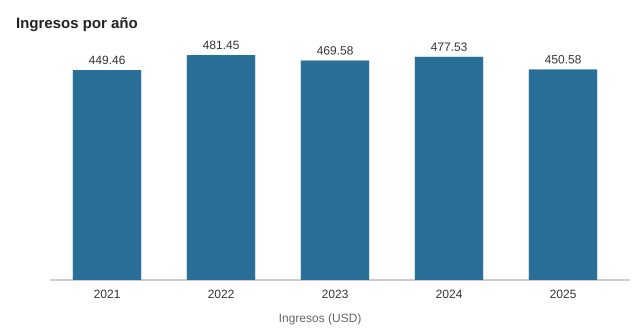
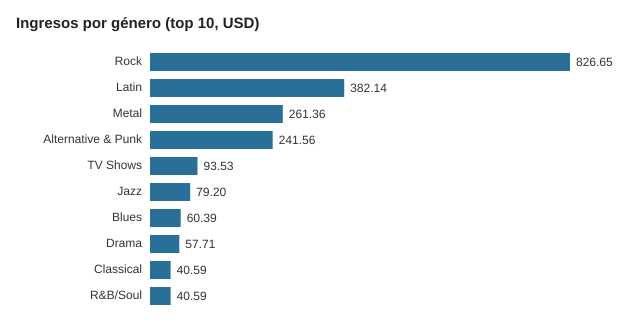
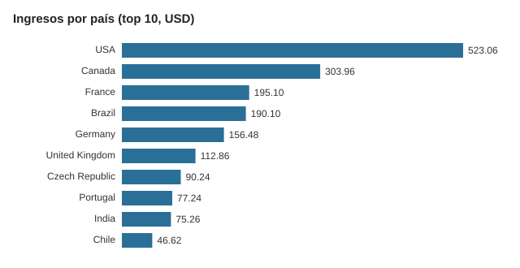

# Análisis de ventas de Chinook con SQL y Python

Análisis exploratorio de ventas de una tienda de música digital (base de datos **Chinook**, SQLite). El objetivo es responder preguntas de negocio con SQL (JOINs, agregaciones, CTEs y funciones de ventana) y presentar los resultados con Python (pandas y matplotlib).

## Preguntas que responde

1. ¿Cómo evolucionan los ingresos por año?
2. ¿Qué países y clientes generan más ingresos?
3. ¿Qué géneros, artistas y formatos concentran las ventas?
4. ¿Cómo rinden los clientes atendidos por cada representante de soporte?

## Datos

- Fuente: [Chinook Database](https://github.com/lerocha/chinook-database) (archivo `Chinook_Sqlite.sqlite`).
- 11 tablas: 59 clientes, 412 facturas (2021-01-01 a 2025-12-22), 2.240 líneas de factura y 3.503 canciones.
- El archivo `.sqlite` no está en este repositorio; descárgalo desde el enlace anterior.

## Cómo reproducirlo

```bash
pip install pandas matplotlib
python analysis.py ruta/a/Chinook_Sqlite.sqlite
```

El script ejecuta cada consulta de `queries.sql`, guarda los resultados en `resultados/` (CSV) y genera tres gráficos (PNG).

## Archivos

| Archivo | Contenido |
|---|---|
| `queries.sql` | 7 consultas SQL comentadas, una por pregunta |
| `analysis.py` | Ejecuta las consultas, exporta CSV y crea los gráficos |

## Resultados

Ingresos totales del periodo: **US$ 2.328,60**.

**Ingresos por año**

| Año | Facturas | Ingresos (USD) | Crecimiento |
|---|---|---|---|
| 2021 | 83 | 449,46 | n/d |
| 2022 | 83 | 481,45 | +7,1 % |
| 2023 | 83 | 469,58 | -2,5 % |
| 2024 | 83 | 477,53 | +1,7 % |
| 2025 (hasta el 22 dic.) | 80 | 450,58 | -5,6 % |

**Top 5 países por ingresos**

| País | Clientes | Ingresos (USD) | Ticket promedio (USD) |
|---|---|---|---|
| USA | 13 | 523,06 | 5,75 |
| Canada | 8 | 303,96 | 5,43 |
| France | 5 | 195,10 | 5,57 |
| Brazil | 5 | 190,10 | 5,43 |
| Germany | 4 | 156,48 | 5,59 |

**Top 5 géneros por ingresos**

| Género | Ingresos (USD) | Participación |
|---|---|---|
| Rock | 826,65 | 35,5 % |
| Latin | 382,14 | 16,4 % |
| Metal | 261,36 | 11,2 % |
| Alternative & Punk | 241,56 | 10,4 % |
| TV Shows | 93,53 | 4,0 % |

**Top 5 artistas por ingresos**

| Artista | Ingresos (USD) | Unidades |
|---|---|---|
| Iron Maiden | 138,60 | 140 |
| U2 | 105,93 | 107 |
| Metallica | 90,09 | 91 |
| Led Zeppelin | 86,13 | 87 |
| Lost | 81,59 | 41 |

**Representantes de soporte**

| Representante | Clientes | Ingresos (USD) | Ingresos por cliente (USD) |
|---|---|---|---|
| Jane Peacock | 21 | 833,04 | 39,67 |
| Margaret Park | 20 | 775,40 | 38,77 |
| Steve Johnson | 18 | 720,16 | 40,01 |

## Hallazgos

- Los ingresos anuales son estables, entre US$ 450 y 481, sin una tendencia clara de crecimiento. En 2025 hay menos facturas (80) porque el registro termina el 22 de diciembre.
- Estados Unidos aporta cerca del 22 % de los ingresos y, con Canadá, supera el 35 %.
- Cuatro géneros (Rock, Latin, Metal y Alternative & Punk) suman 73,5 % de los ingresos.
- El formato MPEG audio concentra 84 % de las ventas.
- Los tres representantes generan ingresos por cliente muy parecidos (entre US$ 38,77 y 40,01), por lo que la diferencia entre ellos viene del número de clientes asignados.
- Entre los 10 países principales, el ticket promedio por factura es similar (entre US$ 5,37 y 6,66), así que el volumen de clientes pesa más que el gasto por compra.

## Técnicas usadas

`JOIN` de varias tablas · `GROUP BY` y agregaciones · CTE (`WITH`) · función de ventana (`LAG`) · subconsultas · `strftime` · lectura de SQL con pandas · gráficos con matplotlib.
## Gráficos

Gráficos en SVG dibujados a partir de los resultados de las consultas (carpeta `graficos/`). El script `analysis.py` genera además sus propias versiones en PNG.






